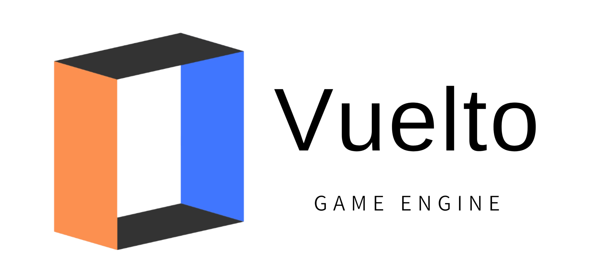

---
hide:
  - navigation
---

<!-- markdownlint-disable md033 -->
<style>
  .md-typeset h1,
  .md-content__button {
    display: none;
  }
</style>



<a href="https://github.com/vuelto-org/vuelto">
  
</a>
<a href="https://github.com/vuelto-org/license">
  
</a>
<a href="https://github.com/vuelto-org/vuelto/actions/workflows/ci_check.yml">
  
</a>
<a href="https://github.com/vuelto-org/vuelto">
  
</a>
<a href="https://www.opengl.org/Documentation/Specs.html">
  
</a>
<a href="https://beua.today">
  
</a>

Welcome to the Vuelto website! Here you will find things like documentation, blogs, tutorials and everything about Vuelto!

## ℹ️  About

Vuelto is an open-source, fast, and lightweight game engine, based on Golang and OpenGL. Designed with simplicity and speed in mind, while still staying relatively lightweight. It can be deployed on almost all major platforms, including Linux, MacOS, Windows and Web.

!!! note
    While Vuelto has a stable version, it's pretty much experimental and educational software. Want something rock solid? Try [Ebitengine](https://github.com/hajimehoshi/ebiten)!

## ✨ Features

- 🌍 Cross Platform
- 🛠️ Open-Source
- 📚 Easy to learn
- 🚀 Fully built using CGo (and some other libraries)

## 📦 Installation

### 📋 Requirements

You need to have the following installed on your system:

- 🖥️ A C compiler (due to CGo)
- 🔧 A Go compiler (Go 1.23 and above)
- 🪟 Xorg/Wayland development packages (For Linux only)
- 🖱️ Supported platform

For an installation guide, [go here](https://vuelto.pp.ua/install/).

### 🐹 Go package

You can get the latest Go package by running this command:

```sh
go get vuelto.pp.ua@latest
```

## 🖥️ Platform support

Vuelto has built-in deployment support for the following platforms:

| Platform | Status | Version |
| :---- | :---- | :---- |
| Windows | ✅ | v1.0 |
| macOS (Darwin) | ✅ | v1.0 |
| Linux | ✅ | v1.0 |
| Web | ✅ | v1.1 |

## 📖 Docs

You can check out Vuelto's documentation at [Vuelto's website](https://vuelto.pp.ua/docs/).

!!! tip
    In case the documentation is missing something or there is something wrong, use the [GoDoc](https://pkg.go.dev/vuelto.pp.ua) page for API documentation. Use the [examples](https://github.com/vuelto-org/vuelto/tree/stable/examples) directory for usage examples.

### 🛣️ Roadmap

Our roadmap is available on the website (URL here) or in the ROADMAP.md file in the root of the GitHub repo.

### 🤝 Contributing

Are you looking to contribute? Please see our [Contributing Guide](https://github.com/vuelto-org/vuelto/blob/latest/contributing.md) for details.

## 🛡️ Support & Security

### 🐛 Issues

See [Issues](https://github.com/vuelto-org/vuelto/issues) page for current bugs and feature requests. In case you find any bug or have a suggestion, please open up an issue!

#### 🔒 Security Issues

If you find a security vulnerability, please follow the instructions in [SECURITY.md](https://github.com/vuelto-org/vuelto/blob/latest/security.md) to safely report it.

### 🔐 License

Vuelto is licensed under the [VL-Cv1.1 License](https://vuelto.pp.ua/about/license). Any PRs that primarily focus on changing the license won't be accepted.

!!! note
    Vuelto was archived between Jul 26 2025 and Nov 12 2026. For this reason, everything pre November 12 2026 is now open MIT code, following VL-Cv1.1. Everything past November 12 2026 is back to the standard license guidelines.

### ℹ️ About

All of our contact info, project info and our team/partners can be found on the [About](https://vuelto.pp.ua/about/) page.
